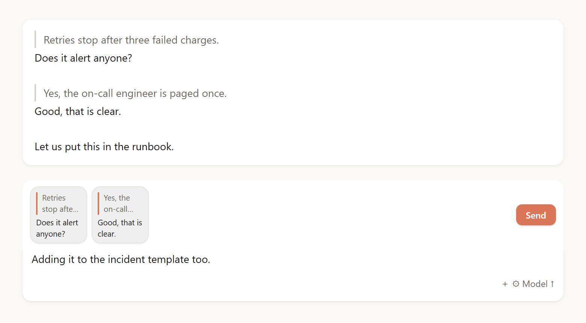
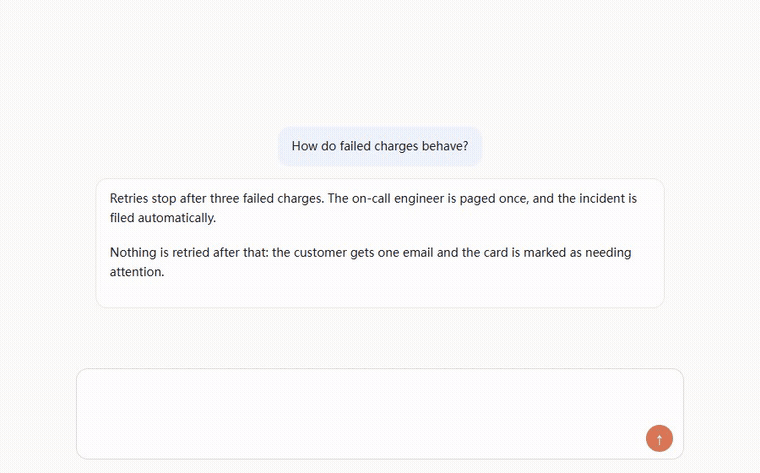
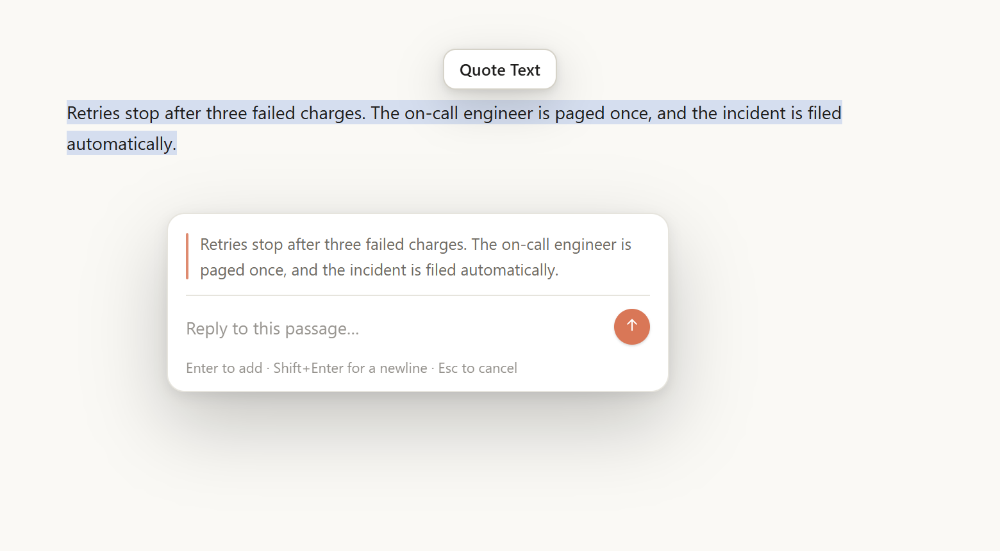

# dsh-quote-reply

Quote & reply for [DeepSeek Harness](https://github.com/deepseek-ai/deepseek-harness), the way Claude Code does it.

[中文](README.zh.md) · DSH 0.2.x

Select text → answer it in a popover → the pair becomes a block above the composer → send them all at once.

## Features

- Selection pill, reply popover, `Enter` to add.
- 76×76 blocks: two quote lines with a rule, two lines of your answer.
- Composer text stays yours; it lands last in the message.
- Images in the draft travel with the message.
- Real quote rules in the transcript, not `│` characters.
- Chinese and English, following the app language.

## Install

Requires DSH 0.2.x with the desktop/web conversation UI.

- **npm** → `dsh plugin add dsh-quote-reply`
- **Plugin Manager** → *Add plugin* → this directory.
- **Git** → `plugin_manager install_bundle target: git+https://github.com/gf691271/dsh-quote-reply#<commit>`
- **Market index** → add `https://raw.githubusercontent.com/gf691271/dsh-quote-reply/main/market/index.json`

## Usage

1. Select text in any message.
2. Click `Quote Text`, write your answer, press `Enter`.
3. Repeat, then press `Enter` in the composer (or click **Send**).

## Notes

- `│` at the start of a line is the storage marker; the transcript renders it as a rule.
- A send the host refuses keeps your blocks and text; nothing is lost.
- File attachments (PDF, zip) cannot ride a quote and stop the send with a notice.

If this saved you a few clicks, a ⭐ helps other people find it.
