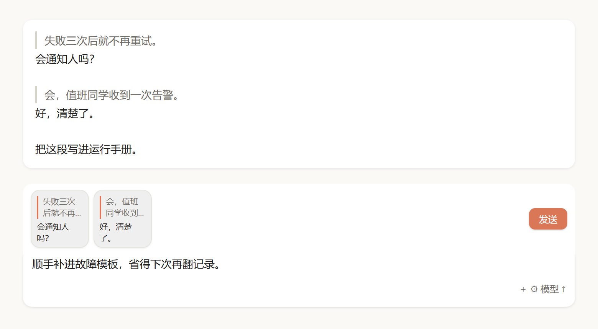
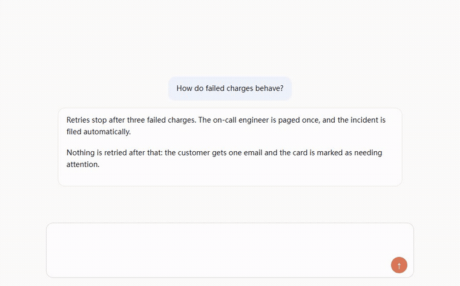
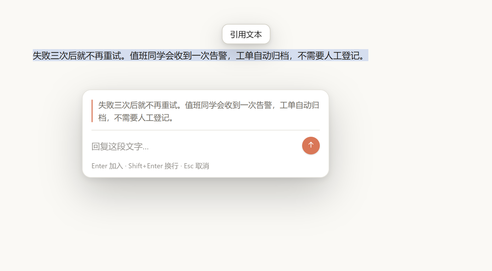

# dsh-quote-reply

给 [DeepSeek Harness](https://github.com/deepseek-ai/deepseek-harness) 用的引用回复，交互和 Claude Code 一样。

[English](README.md) · DSH 0.2.x

选中文字 → 浮窗里写回复 → 问答变成输入框上方的方块 → 攒够了一次性发出。

## 功能

- 选中浮出「引用文本」，回车即可加入；
- 76×76 方块：两行引文带竖线，两行回复；
- 输入框照常打字，内容排在消息最后；
- 输入框里的图片随消息一起发出；
- 消息里是真竖线，不是 `│` 字符；
- 中英文随界面语言切换。

## 安装

需要带 Web/桌面对话界面的 DSH 0.2.x。

- **npm** → `dsh plugin add dsh-quote-reply`
- **插件管理器** → 添加插件 → 选这个目录；
- **Git** → `plugin_manager install_bundle target: git+https://github.com/gf691271/dsh-quote-reply#<commit>`
- **市场索引** → 添加 `https://raw.githubusercontent.com/gf691271/dsh-quote-reply/main/market/index.json`

## 用法

1. 在任意消息里选中文字；
2. 点「引用文本」，写回复，回车；
3. 继续选，最后在输入框回车（或点「发送」）。

## 说明

- 行首的 `│` 只是存储标记，消息里会渲染成竖线；
- 宿主拒绝发送时，方块和文字都保留，不丢内容；
- 文件附件（PDF、zip）不能随引用发送，会提示并拒绝。

如果它帮你省了几次复制粘贴，点个 ⭐ 能让更多人看到。
